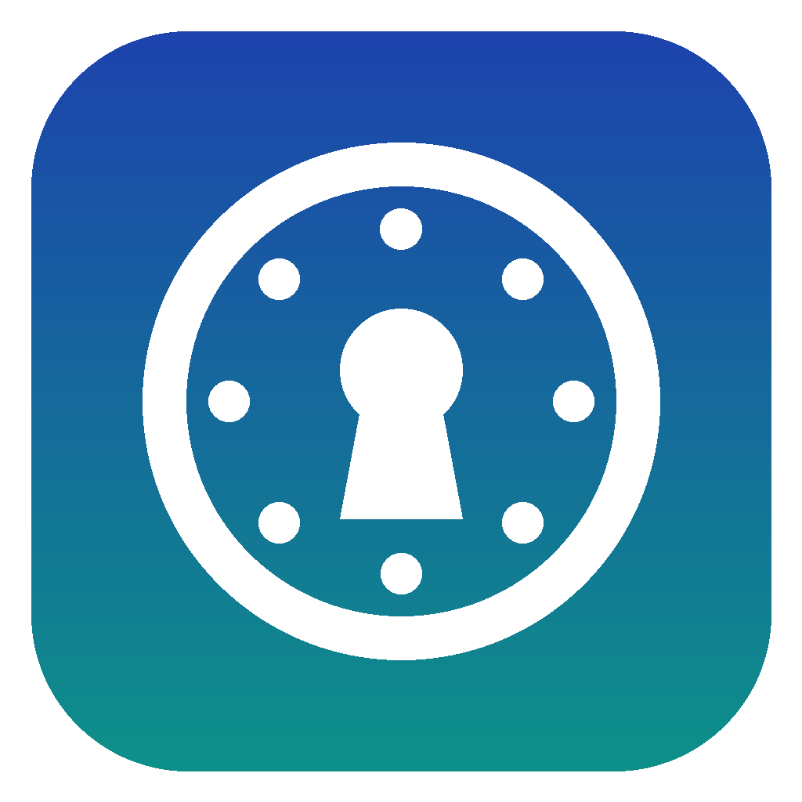
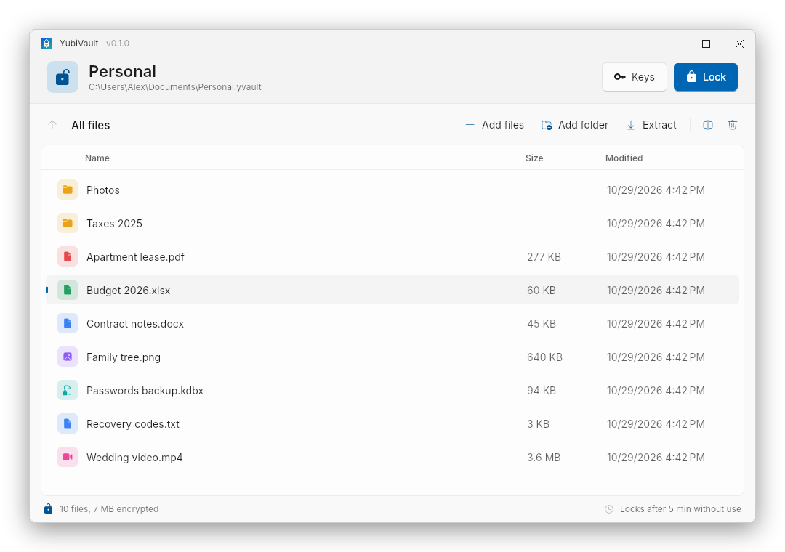
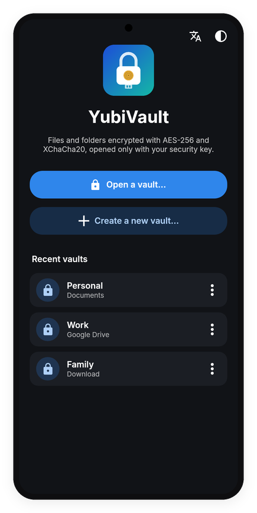
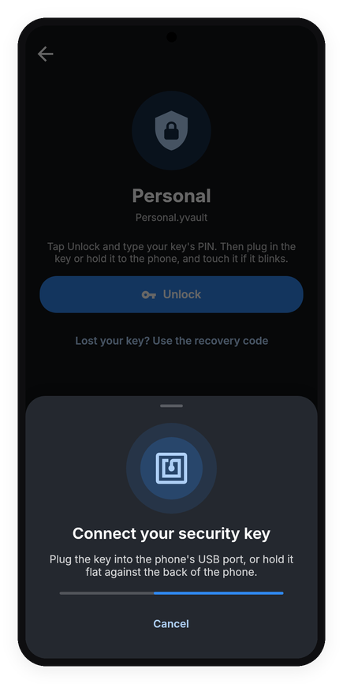
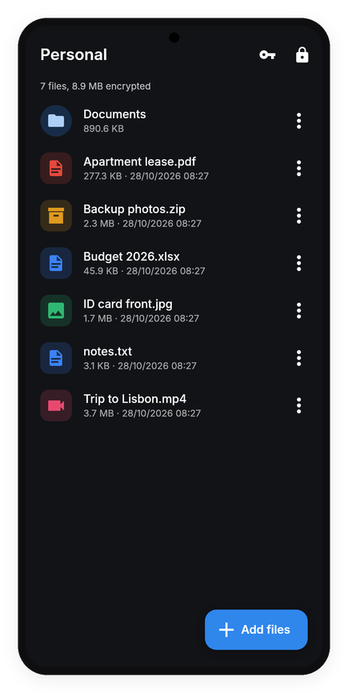
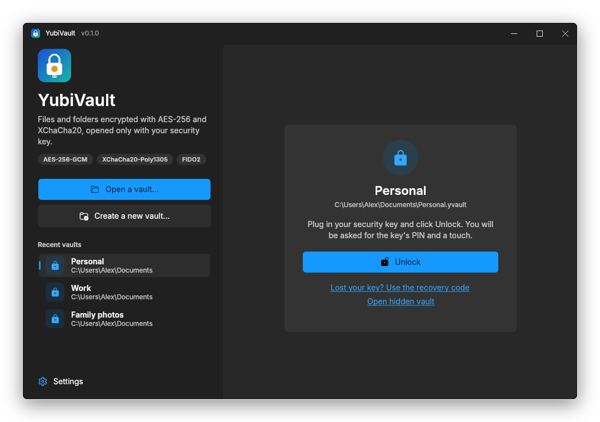

# YubiVault

A portable vault that encrypts files and folders and only opens them with your **YubiKey** or other FIDO2 security key. It runs on Windows, Linux, macOS and Android, and a vault made on one opens on all the others.

On the desktop each download is a single self-contained program: no installation and no administrator rights, so it can live on a USB stick. Linux also has `.deb` and `.rpm` packages, and macOS a ready-to-use `YubiVault.app`. On Android, hold the key to the back of the phone (NFC) or plug it in (USB).

> **Status:** early preview (0.x). Keep a copy of anything important outside the vault until 1.0.

<p align="center">
  
</p>

<p align="center">
  
  
  
</p>

## Features

- **Your security key is the key.** Every unlock asks for the key's PIN and a touch. Lost it? A recovery code, printed when you create the vault, gets you back in, and a second key can be added as a spare.
- **One file per vault.** A vault is a single `.yvault` file you can keep on a USB stick, a disk, OneDrive or Google Drive. From the outside there are no file names, folders, sizes or structure, only encrypted data.
- **Layered encryption.** Every file is encrypted with AES-256-GCM and then XChaCha20-Poly1305, with independent keys.
- **Hidden vault (optional).** A second vault can hide inside a vault's file, in space that looks like random padding, with its own password, security key and recovery code. Nobody can tell it is there, even after opening the outer vault.
- **Locks itself.** After a few minutes without use, when you lock Windows, and on Android as soon as you leave the app. Decrypted copies of opened files are wiped.
- **Works like a folder.** Drag files and folders in, double-click to open, extract, rename and delete. `.yvault` files open with YubiVault from Explorer, Finder or the Linux file manager.
- **Android.** Opens and creates vaults on the phone or on Google Drive, OneDrive and Dropbox, and writes changes straight back. Remembers recent vaults, with a dark or light look and a language choice on the start page.
- **Signed updates in one click.** At start-up the app looks for a newer release on GitHub and offers it. One click downloads it, checks the release's signature and installs it, then restarts: the portable `.exe` and the Linux binary replace themselves, `.deb` and `.rpm` go through the package tool (asking for the administrator password), the macOS app swaps its bundle, and Android opens the system installer. The check can be turned off on the start page.
- **11 languages.** English, Chinese (Simplified and Traditional), Hindi, Spanish, French, Arabic, Bengali, Portuguese, Russian and Japanese, chosen automatically or by hand.

<p align="center">
  
</p>

## Getting started

### Windows

1. Download `YubiVault-<version>-win-x64.zip` from [Releases](../../releases) and unzip it anywhere, even a USB stick.
2. Run `YubiVault.exe`, click **Create a new vault...**, pick a folder and a name, and follow Windows' prompts for your security key's PIN and a touch.
3. Print or write down the recovery code it shows. It is the only way in if you lose your key.
4. Drag files and folders into the window to encrypt them. Double-click to open, or select and **Extract**.

Optional: click **Open .yvault files with YubiVault** on the start screen so that double-clicking a vault opens it. It is registered for your user only and needs no administrator rights.

The zip also has `yubivault-cli.exe`, a command-line version (`yubivault-cli help`).

### Linux

- **Debian, Ubuntu, Mint:** download `yubivault_<version>_amd64.deb` (or `arm64`) and run `sudo apt install ./yubivault_*.deb`.
- **Fedora, RHEL and derivatives:** download `yubivault-<version>-1.x86_64.rpm` (or `aarch64`) and run `sudo dnf install ./yubivault-*.rpm`.
- **Any distribution, portable:** download `YubiVault-<version>-linux-x64.tar.gz` (or `linux-arm64`), unpack it with `tar xzf YubiVault-*.tar.gz` and run `./YubiVault` from that folder. `./install.sh` adds it to your applications menu for your user only, in `~/.local`, without root (`./install.sh --uninstall` removes it).

The packages and `install.sh` put YubiVault in your applications menu and open `.yvault` files with it.

**Security key access.** YubiVault reads the key through `/dev/hidraw*`. On systemd 244 or later (Ubuntu 20.04+, Debian 11+, Fedora 32+ and most current distributions) the `uaccess` tag in systemd's `60-fido-id.rules` already gives the logged-in user access, so there is nothing to do. On older or non-systemd systems, install the rule from the tarball's `share/` folder and replug the key:

```sh
sudo cp share/70-yubivault-fido.rules /etc/udev/rules.d/
sudo udevadm control --reload && sudo udevadm trigger
```

### macOS

1. Download `YubiVault-<version>-osx-arm64.zip` for Apple Silicon or `osx-x64` for Intel Macs, unzip it and drag `YubiVault.app` to Applications (or keep it on a USB stick).
2. YubiVault is free and not notarized by Apple, so the first launch is blocked: right-click the app, choose **Open**, then **Open** again. Or run `xattr -dr com.apple.quarantine YubiVault.app`.
3. `.yvault` files open with YubiVault from Finder. `yubivault-cli` in the zip is the command-line version.

### Android (preview)

1. Download `YubiVault-<version>-android.apk` from [Releases](../../releases) on your phone and open it (Android asks you to allow installing apps from that source). Later versions are offered inside the app. If you installed a test build from a CI run before, uninstall it first: those are signed with a different key.
2. Tap **Open a vault...** and pick a `.yvault` file from the phone, Google Drive, OneDrive or Dropbox, or **Create a new vault...**.
3. Tap **Unlock**, type the key's PIN, then hold the key flat against the back of the phone, or plug it into the USB port and touch it when it blinks.

The app is not on Google Play yet.

## How it works

- **FIDO2 hmac-secret.** YubiVault asks the security key for a secret with the hmac-secret (PRF) extension: through Windows' own security key dialog on Windows, and directly over USB or NFC on Linux, macOS and Android. The secret never leaves the key, and the key gives it only after its PIN and a touch. Works with any YubiKey 5 or Security Key by Yubico, without administrator rights.
- **YubiKey 5 OTP mode (optional, desktop).** YubiKey 5 keys can instead use HMAC-SHA1 challenge-response (slot 2), optionally combined with a password.
- **Key wrapping.** The vault's master key is wrapped once for each security key and once for the recovery code, so keys can be added or removed without re-encrypting anything.
- **Layered encryption.** Every file goes through AES-256-GCM and then XChaCha20-Poly1305, with independent keys derived by HKDF-SHA256. A future break in one algorithm is not enough to expose your data.
- **Updates.** Each release carries `SHA256SUMS.txt` and an Ed25519 signature of it, `SHA256SUMS.txt.sig`, made with the project's release key. The apps hold the public key and install only a file whose hash is in a correctly signed list, under a name that carries the new version, so a hacked GitHub account or download mirror cannot push a modified or older build. You can check a download by hand with `openssl pkeyutl -verify -pubin -inkey docs/update-public-key.pem -rawin -in SHA256SUMS.txt -sigfile SHA256SUMS.txt.sig`.
- **Hidden vault.** It lives in random padding that every vault file can carry, so without its password a vault with a hidden vault looks like one without. This protects against someone who sees one copy of the file, not against someone who compares copies over time, such as a cloud drive's version history.

The file format is described in [docs/format.md](docs/format.md).

## Requirements

- **Windows** 10 or 11, 64-bit; FIDO2 needs Windows 11 22H2 or later (OTP mode also works on Windows 10)
- **Linux** x64 or ARM64 with a desktop session (X11, or Wayland through XWayland)
- **macOS** 14 or later, Apple Silicon or Intel
- **Android** 8.0 or later, with NFC or a USB port that accepts the key (USB-C, or USB-A through an OTG adapter)
- A FIDO2 security key with hmac-secret and a PIN set (YubiKey 5 series, Security Key by Yubico, and others)

## Roadmap

1. [x] Technical design
2. [x] Encryption core and command-line tool, with tests
3. [x] Vault desktop app
4. [x] Single portable executable for Windows x64, released from tags by GitHub Actions
5. [x] Windows, Linux and macOS (Avalonia), in 11 languages, with `.deb`, `.rpm` and macOS `.app` packages
6. [x] Android app, with FIDO2 over NFC and USB
7. [x] Hidden vaults
8. [x] Signed one-click updates on every platform, and the Android APK on Releases
9. [ ] Google Play

## Built with

C# and .NET 10, [Avalonia](https://avaloniaui.net/) for the interface on the desktop and on Android (with [FluentAvalonia](https://github.com/amwx/FluentAvalonia) on the desktop), the [official Yubico .NET SDK](https://github.com/Yubico/Yubico.NET.SDK), a small CTAP2 client of its own for Android, [NSec](https://nsec.rocks/) (libsodium) for XChaCha20-Poly1305 and Argon2id, and the operating system's native cryptography for AES-256-GCM.

The screenshots in [docs/screenshots](docs/screenshots) are rendered from the app itself, with sample files.

## License

[GPLv3](LICENSE). YubiVault is an independent project and is not affiliated with Yubico. YubiKey is a registered trademark of Yubico AB.
